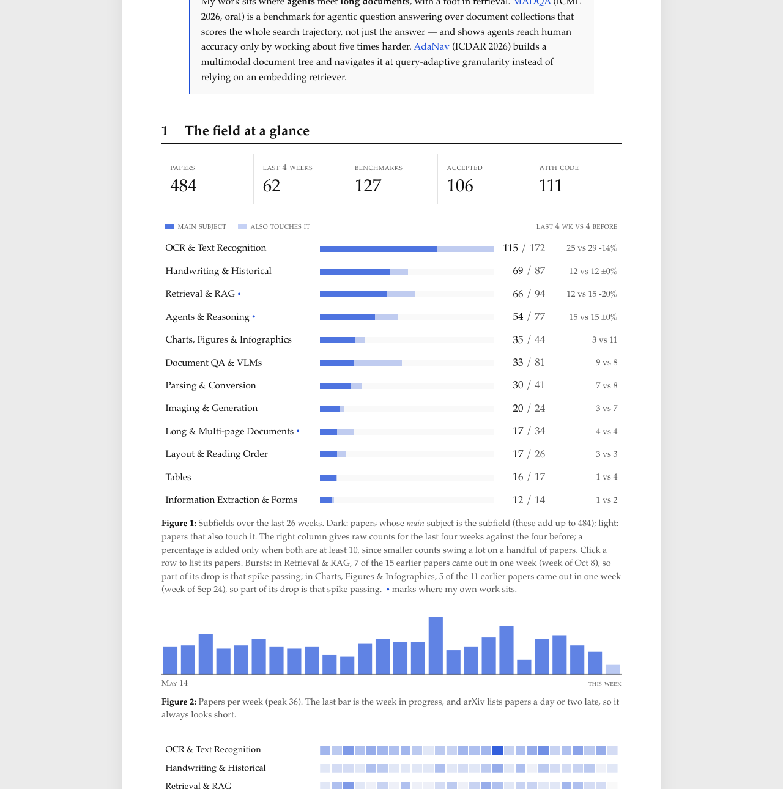
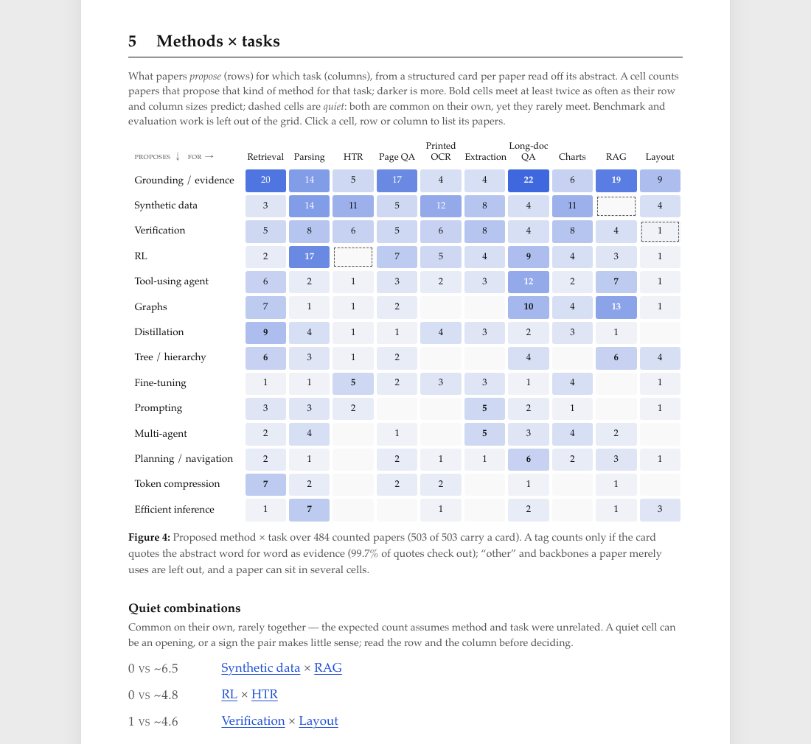

# living-survey

**A living survey of your research field.** Every morning it reads the new arXiv papers in your area, files them into subfields, and publishes a map: what is growing, what is rising, where subfields meet, which methods are used for which tasks — and which combinations nobody has tried yet.

You describe your field in one file. GitHub runs it and hosts it, for free. There is no server to run.

**Live → [ym-xu.github.io/living-survey](https://ym-xu.github.io/living-survey/)**: every field on one page. Tick the subfields you care about and their new papers collect in *My feed* (kept in your browser, never sent anywhere); every subfield also has its own RSS feed.

<a href="https://ym-xu.github.io/living-survey/"></a>

## What you get

- **The field at a glance:** papers per subfield, the last four weeks against the four before, and a weekly heat map.
- **Subfields:** each with its trend, representative papers, and your own short overview if you write one.
- **What's moving:** rising title terms (log-odds with an informative prior, not raw counts), subfields that share papers, venues, active authors, papers already being cited, and new benchmarks.
- **Methods × tasks (optional):** a language model reads each abstract and tags what the paper *proposes* and *for which task*. A tag is kept only if its quote appears word for word in the abstract. *Quiet* cells mark pairs that are common on their own but rarely meet.


- **Every paper, filterable:** by subfield, pair, matrix cell, benchmark, venue, code or followed author. Filters live in the URL, so a view can be shared. There is also an RSS feed.

Papers can carry several subfields. The rules are plain regular expressions you can read, and anything they get wrong you can fix by hand in `notes.toml`.

## Make your own (about 5 minutes)

1. Click **Use this template** and create a **public** repository. Its name becomes part of the address: `you.github.io/<name>/`.
2. Delete the `fields/` folder (those are my maps) and copy [`examples/starter.toml`](examples/starter.toml) to `map.toml` at the top, or [`examples/rag.toml`](examples/rag.toml) to see a complete field. Fill in the TODOs.
   *Several fields?* Keep `fields/` instead and give each field its own folder, `fields/<id>/map.toml` (+ an optional `notes.toml`); the front page then lists them all (settings in `fields/catalog.toml`).
3. **Settings → Pages → Source: GitHub Actions.**
4. **Actions → Daily map → Run workflow.** About a minute later your map is live, and it rebuilds every morning at 06:00 UTC.

Delete `data/fields/` too: the cards data in it is for my fields.

### Optional: Figure 4 (methods × tasks)

Add a repository secret `LLM_API_KEY` (**Settings → Secrets and variables → Actions**). The default provider is [DeepSeek](https://platform.deepseek.com). Any OpenAI-compatible API works: also set the repository *variables* `LLM_BASE_URL` (for example `https://api.openai.com/v1` or `https://openrouter.ai/api/v1`) and `LLM_MODEL`.

- A card costs about 1.2k tokens per paper and is made once.
- Each morning only the new papers are sent, at most 150 per run.
- Only public arXiv abstracts are sent.
- Without a key the map works fine; Figure 4 just keeps the cards it already has, or stays hidden.

`S2_API_KEY` (a free [Semantic Scholar](https://www.semanticscholar.org/product/api) key) is also optional; it avoids rate limits on citation counts.

## Tuning the rules

Python 3.11+ and nothing else:

```bash
python3 scripts/build.py fetch     # fetch and file papers, every field -> data/…/survey.json
python3 scripts/build.py cards     # paper cards + Figure 4 (needs LLM_API_KEY)
python3 scripts/build.py serve rag # preview one field, live reload (just `serve` for the whole site)
python3 -m unittest discover -s tests
```

With a single `map.toml`, `python3 scripts/fetch.py` and `hugo server` work as before.

- Look at which papers land where and adjust the `match` rules in `map.toml`.
- If a whole family of false positives gets in, add a pattern to `[filter] exclude`.
- For a single paper, add it to `exclude` or `include` in `notes.toml`. An included paper is fetched by id if the query misses it; give it `tag = "<subfield id>"` if no rule matches it.
- If the log warns that the result cap was hit, the oldest weeks are incomplete: narrow `[arxiv] queries` or lower `[map] weeks`.
- A broken regular expression stops the run with a message that names the rule.

## The two files

| File | What it holds | Required |
|---|---|---|
| `map.toml` | Title, the arXiv query, what counts as the field, the subfield rules, rising-term stop words, and the method/task lists for Figure 4. | yes |
| `notes.toml` | Hand corrections (`exclude`, `include`), pinned papers per subfield, picks with a note, subfield overviews, key references, a benchmark table. | no |

Everything else (layout, styles, scripts) works the same for every field.

## How it works

```text
                 for every field (build.py)
arXiv API ──> fetch.py ──> survey.json ──┐
                  │                      ├──> Hugo ──> /fields/<id>/ + feeds/<subfield>.xml ─┐
Semantic Scholar ─┘     cards.py ──> survey_cards.json                                       ├──> GitHub Pages
                        (LLM, optional)            catalog of all fields + "My feed" ──> / ──┘
```

- With several fields, arXiv is asked once per run for the union of their queries (`scripts/pool.py`, cached in `scripts/.cache/`); each field then applies its own query locally, the way arXiv's search does (Porter-stemmed words, phrases in order), so its papers are the same as if it had asked arXiv itself. The whole window is re-read weekly; other days only the newest pages. All arXiv calls go through `scripts/arxiv.py`: ≥3.5 s apart, and on HTTP 429/503 it honours `Retry-After` and backs off from 30 s.
- Each paper is scored against every subfield rule: title hits count three times, abstract hits once (capped).
- A paper gets a subfield when it scores at least 2, and its strongest subfield is its main subject.
- Generated data is never committed. The GitHub Actions cache keeps yesterday's copy, so an arXiv outage just means yesterday's map.
- The whole thing uses the Python standard library and Hugo.

## Credits

Thank you to arXiv for use of its open access interoperability. Citation counts, author IDs and venues come from Semantic Scholar. The page is set in TeX Gyre Pagella (GUST Font License).

MIT licensed. If you run a map of your own field, open a PR adding it to the list below.

### Maps

- [Document Understanding](https://ym-xu.github.io/living-survey/fields/document-understanding/) — layout, OCR, tables, charts, document QA, long documents, retrieval and agents.
- [Retrieval-Augmented Generation](https://ym-xu.github.io/living-survey/fields/rag/) — retrievers, graphs, agentic RAG, evaluation.
